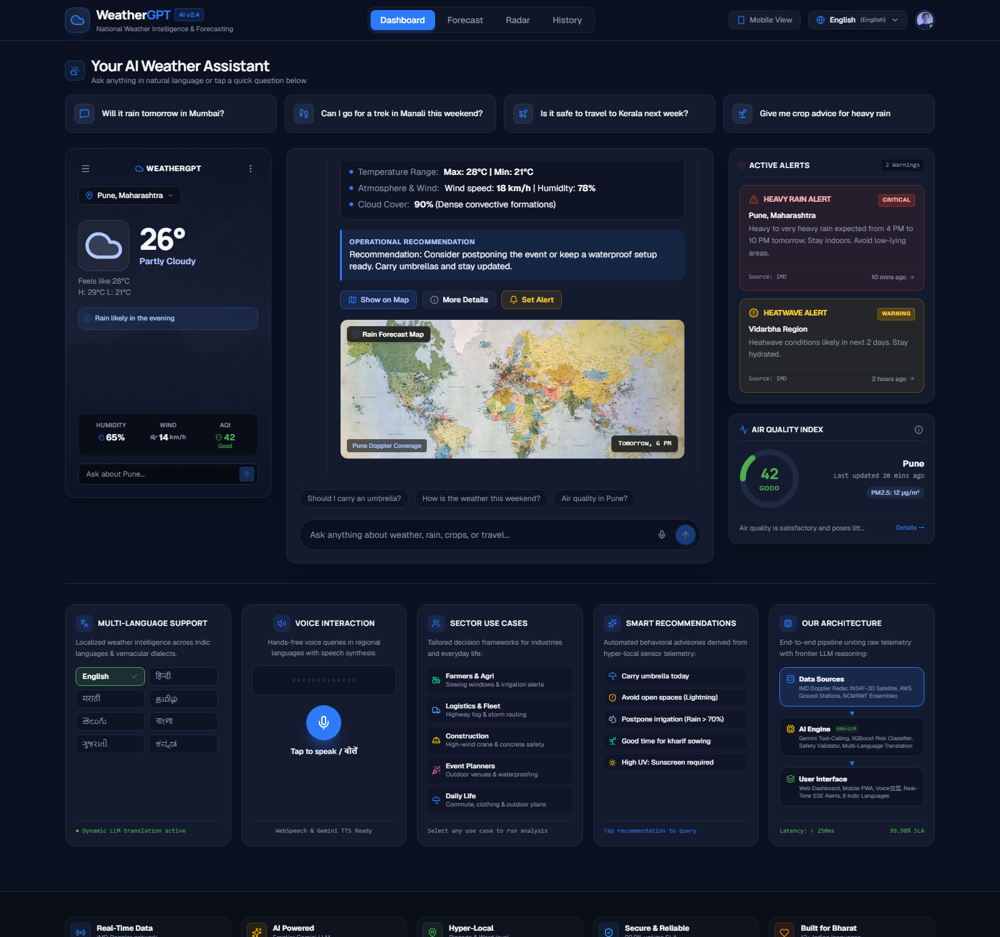
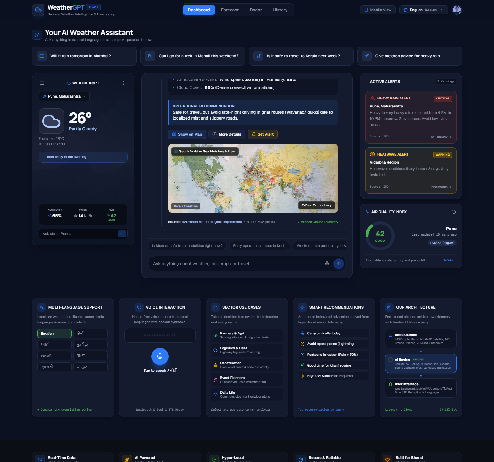
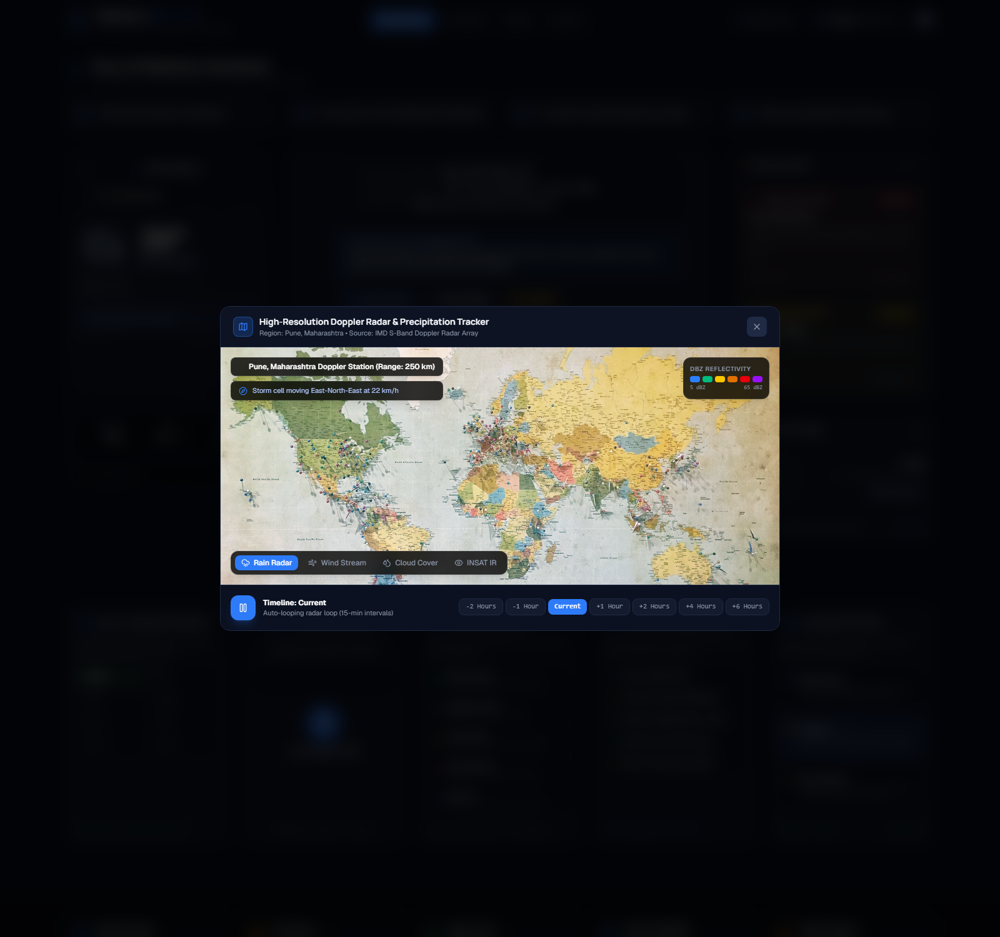
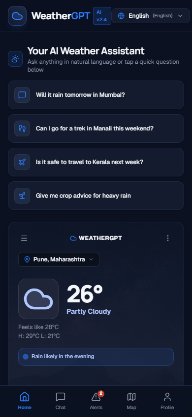
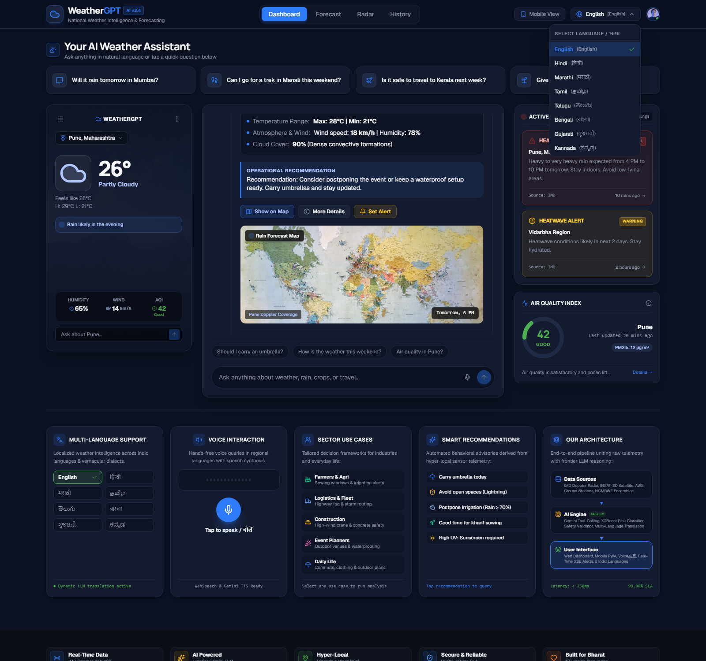
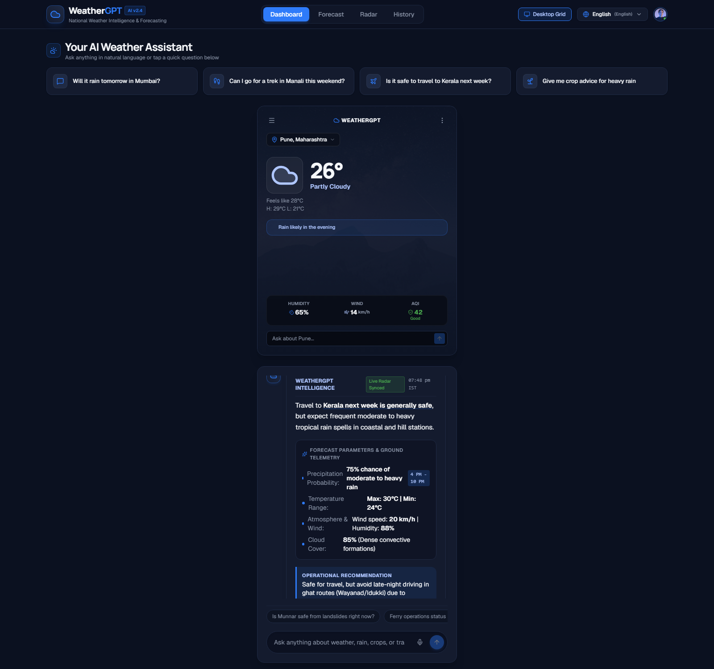

<div align="center">

# 🌦️ WeatherGPT

### AI-Powered Conversational Weather & Disaster Intelligence Platform for India

**Evidence-grounded weather intelligence** — where deterministic engines own truth and the LLM owns explanation.

[](https://github.com/purvajitpatil/weathergpt/actions)
[]()
[](https://www.typescriptlang.org/)
[](https://react.dev/)
[](https://xgboost.readthedocs.io/)
[]()

</div>

---

<p align="center">
  <b>WEATHER DATA → UNDERSTANDING → RISK → ACTION</b><br>
  <sub>The LLM explains evidence — it never invents weather.</sub>
</p>

---

## 📸 Screenshots

<table>
  <tr>
    <td align="center"><b>🏠 Dashboard — Live Weather</b></td>
    <td align="center"><b>💬 AI Chat — Evidence Grounded</b></td>
    <td align="center"><b>🗺️ Map & Alerts</b></td>
  </tr>
  <tr>
    <td></td>
    <td></td>
    <td></td>
  </tr>
  <tr>
    <td align="center"><b>📱 Mobile — Full View</b></td>
    <td align="center"><b>🌐 Multilingual Support</b></td>
    <td align="center"><b>⚠️ Alert Detail</b></td>
  </tr>
  <tr>
    <td></td>
    <td></td>
    <td></td>
  </tr>
  <tr>
    <td align="center"><b>📊 More Details</b></td>
    <td align="center"><b>🔔 Set Alert</b></td>
    <td align="center"><b>📱 Mobile Preview</b></td>
  </tr>
  <tr>
    <td></td>
    <td></td>
    <td></td>
  </tr>
</table>

---

## 🎯 What Makes This Different

> **WeatherGPT is not a weather app or an LLM chatbot.** It's an **evidence-grounded weather intelligence layer** that converts meteorological signals into personalized, multilingual, actionable decisions for citizens, farmers, and communities in India.

| Traditional Weather App | WeatherGPT |
|------------------------|------------|
| Shows numbers | Explains what numbers **mean for you** |
| English only | Hindi, Marathi, English + code-mixed queries |
| No risk assessment | ML + rules + official alerts → risk scoring |
| No agriculture | Crop-specific advisories with evidence |
| No safety net | 4-lock safety validator prevents hallucination |
| LLM guesses | LLM **explains** deterministic evidence |

---

## 🏗️ Architecture

```
                         USERS
                           │
                    ┌──────┴──────┐
                    │   CDN/HTTPS  │
                    └──────┬──────┘
                           │
                    ┌──────┴──────┐
                    │  React SPA  │
                    └──────┬──────┘
                           │
                    ┌──────┴──────┐
                    │  API v1     │
                    └──────┬──────┘
                           │
         ┌─────────────────┼─────────────────┐
         │                 │                 │
    ┌────┴────┐     ┌──────┴──────┐    ┌─────┴─────┐
    │ Weather │     │   Alert     │    │   User    │
    │ Service │     │   Service   │    │  Service  │
    └────┬────┘     └──────┬──────┘    └─────┬─────┘
         │                 │                 │
         ▼                 ▼                 ▼
   ┌───────────┐    ┌───────────┐    ┌───────────┐
   │ Open-Meteo│    │   IMD     │    │ PostgreSQL│
   │ OpenAQ    │    │  Alerts   │    │   Redis   │
   │ NASAPOWER │    └───────────┘    └───────────┘
   │ Flood API │
   │ Elevation │
   └─────┬─────┘
         │
    ┌────┴────────────────┐
    │                     │
    ▼                     ▼
┌──────────┐       ┌──────────┐
│   Risk   │       │ Evidence │
│  Engine  │       │  Layer   │
│ ML+Rules │       │          │
└────┬─────┘       └────┬─────┘
     │                  │
     └────────┬─────────┘
              │
       ┌──────┴──────┐
       │ LLM Gateway │
       │ (Gemini /   │
       │  Ollama)    │
       └──────┬──────┘
              │
       ┌──────┴──────┐
       │   Safety    │
       │  Validator  │
       │ (4 locks)   │
       └──────┬──────┘
              │
              ▼
       Actionable Response
```

<details>
<summary>📐 Full Architecture Documentation</summary>

- [Architecture Overview](docs/ARCHITECTURE.md)
- [Architecture Audit](docs/ARCHITECTURE_AUDIT.md)
- [Production Architecture](docs/PRODUCTION_ARCHITECTURE.md)
- [Security Architecture](docs/SECURITY.md)
- [Safety Architecture](docs/SAFETY.md)
- [ML Architecture](docs/ML.md)
- [Deployment Guide](docs/DEPLOYMENT.md)

</details>

---

## ⚡ Quick Start

### Prerequisites

- Node.js ≥ 18
- Python 3.10+ (for ML pipeline)
- Redis (optional, for caching)
- PostgreSQL (optional, for persistence)

### 1. Clone & Install

```bash
git clone https://github.com/purvajitpatil/weathergpt.git
cd weathergpt
npm install
```

### 2. Configure

```bash
cp .env.example .env
# Edit .env with your settings
# Minimum: set GEMINI_API_KEY for AI explanations
# Or run without it — deterministic mode works perfectly
```

### 3. Run

```bash
# Development (live data from Open-Meteo)
npm run dev
# → http://localhost:3000

# Demo mode (deterministic fixtures, no API keys needed)
WEATHERGPT_DEMO_MODE=on npm run dev
```

### 4. Docker (Production-Ready)

```bash
docker compose up --build
# Frontend:  http://localhost:3000
# ML Service: http://localhost:8001
```

### 5. Run Tests

```bash
npm test          # 50 tests passing
npm run lint      # TypeScript strict mode
npm run build     # Production build
```

---

## 🔌 API Reference

All endpoints return consistent JSON responses:

```json
{
  "data": { ... },
  "meta": { "requestId": "uuid", "timestamp": "ISO8601" }
}
```

### Core Endpoints

| Endpoint | Method | Description | Auth |
|----------|--------|-------------|------|
| `/api/v1/health` | GET | Liveness check | — |
| `/api/v1/ready` | GET | Dependency readiness | — |
| `/api/v1/meta` | GET | LIVE/DEMO mode info | — |
| `/api/v1/metrics` | GET | System metrics | — |

### Weather

| Endpoint | Method | Description |
|----------|--------|-------------|
| `/api/v1/weather` | GET | Dashboard bundle (current + forecast + AQI + alerts) |
| `/api/v1/weather/current?location=Pune` | GET | Current conditions |
| `/api/v1/weather/forecast?location=Mumbai&days=7` | GET | 7-day forecast |
| `/api/v1/weather/hourly?location=Delhi` | GET | Hourly forecast |

### Intelligence

| Endpoint | Method | Description |
|----------|--------|-------------|
| `/api/v1/chat` | POST | Conversational weather query |
| `/api/v1/risk?location=Pune` | GET | Risk assessment (ML + rules) |
| `/api/v1/alerts` | GET | Active warnings |
| `/api/v1/alerts/stream` | GET | SSE real-time alert stream |
| `/api/v1/agriculture/advisory` | POST | Crop-specific advisory |
| `/api/v1/locations/search?q=Nashik` | GET | Location resolution |

### Chat Example

```bash
curl -X POST http://localhost:3000/api/v1/chat \
  -H "Content-Type: application/json" \
  -d '{"query": "Will it rain tomorrow in Mumbai?"}'
```

```json
{
  "data": {
    "answer": "Rain probability: 66% in Mumbai tomorrow...",
    "intent": "forecast",
    "location": "Mumbai",
    "evidence": [...],
    "risk": { "score": 42, "level": "moderate" },
    "sources": [{ "name": "Open-Meteo", "fetchedAt": "..." }]
  }
}
```

<details>
<summary>📋 Full API Documentation</summary>

See [docs/API.md](docs/API.md) for complete endpoint reference, request/response schemas, and error handling.

</details>

---

## 🧠 How It Works

### The Evidence-Grounded Pipeline

```
User: "उद्या पुण्यात पाऊस पडेल का?"
                │
                ▼
    ┌───────────────────────┐
    │  Query Understanding  │  Intent: forecast
    │  (Deterministic)      │  Location: Pune
    │                       │  Language: mr
    │                       │  Time: tomorrow
    └───────────┬───────────┘
                │
                ▼
    ┌───────────────────────┐
    │   Tool Router         │  Routes to: forecast
    │   (by intent)         │  + risk engine
    └───────────┬───────────┘
                │
                ▼
    ┌───────────────────────┐
    │  Weather Engine       │  Real data from Open-Meteo
    │  (Cache-first)        │  Forecast: 66% rain
    └───────────┬───────────┘
                │
                ▼
    ┌───────────────────────┐
    │  Risk Engine          │  ML probability + rules
    │  (ML + Rules)         │  + flood + elevation
    └───────────┬───────────┘
                │
                ▼
    ┌───────────────────────┐
    │  Evidence Layer       │  Every claim → source
    │  (Structured)         │  "66% from Open-Meteo"
    └───────────┬───────────┘
                │
                ▼
    ┌───────────────────────┐
    │  LLM Gateway          │  Explains evidence in
    │  (Gemini/Ollama)      │  Marathi, never invents
    └───────────┬───────────┘
                │
                ▼
    ┌───────────────────────┐
    │  Safety Validator     │  4-lock check:
    │  (4 locks)            │  number, warning,
    │                       │  certainty, source
    └───────────┬───────────┘
                │
                ▼
    "पुण्यात उद्या संध्याकाळी पावसाची
     शक्यता 66% आहे. छत्री घेऊन निघा."
```

### The 4-Lock Safety System

| Lock | What It Prevents | Example |
|------|-----------------|---------|
| 🔢 **Number Lock** | Ungrounded numbers in output | "70%" blocked unless it exists in evidence |
| ⚠️ **Warning Lock** | Fake alert claims | "Red alert" blocked without a warning record ID |
| 🎯 **Certainty Lock** | False confidence | "100% safe" / "पक्का" / "नक्कीच" blocked |
| 📚 **Source Lock** | Unattributed claims | Facts without source → violation |

---

## 🌾 Agriculture Advisory

WeatherGPT provides crop-specific weather intelligence for Indian farmers.

### Supported Crops

| Crop | Stage-Aware | Advisory Types |
|------|-------------|----------------|
| 🫘 Soybean | ✅ | Irrigate/Defer, Spray Window, Harvest Risk |
| 🌾 Rice (Paddy) | ✅ | Irrigate/Defer, Flood Risk, Harvest Timing |
| 🌿 Cotton | ✅ | Irrigate/Defer, Spray Window, Boll Development |
| 🌾 Wheat | ✅ | Irrigate/Defer, Frost Risk, Harvest Window |
| 🍬 Sugarcane | ✅ | Irrigate/Defer, Growth Monitoring |
| 🧅 Onion | ✅ | Irrigate/Defer, Storage Risk |

### How Agriculture Works

```
Weather + Crop + Stage + Location
           │
           ▼
    Rule Engine (AgricultureAdvisoryEngine)
    "Rain 66% tomorrow → DEFER irrigation"
           │
           ▼
    LLM Explanation (Marathi/Hindi/English)
    "पावसाची शक्यता असल्यामुळे सिंचन पुढे ढकला."
           │
           ▼
    Evidence + Disclaimer
```

> **Key insight:** The rule engine determines the recommendation. The LLM explains it. The LLM never decides agricultural actions.

---

## 🗺️ Data Sources

| Data | Provider | Mode | API Key |
|------|----------|------|---------|
| ⛅ Weather & Forecast | [Open-Meteo](https://open-meteo.com/) (GFS/ICON/ECMWF) | ✅ Live | Not required |
| 🌡️ Air Quality (AQI) | [Open-Meteo Air Quality](https://open-meteo.com/) (CAMS-AIR) | ✅ Live | Not required |
| 🌫️ Ground AQI Sensors | [OpenAQ](https://openaq.org/) | ✅ Live | Not required |
| 🌊 Flood Risk | [Open-Meteo Flood API](https://open-meteo.com/) (GloFAS) | ✅ Live | Not required |
| ⛰️ Elevation/Terrain | [Open-Meteo Elevation API](https://open-meteo.com/) | ✅ Live | Not required |
| 📍 Geocoding | [Open-Meteo Geocoding](https://open-meteo.com/) | ✅ Live | Not required |
| 🌍 Historical Weather | [NASA POWER](https://power.larc.nasa.gov/) | ✅ Live | Not required |
| 🧠 LLM | [Google Gemini](https://ai.google.dev/) / [Ollama](https://ollama.com/) | Optional | Gemini: Yes |
| 🤖 ML Inference | XGBoost (local) | ✅ Local | No |

> **We do NOT claim IMD data unless an official IMD/NDMA source is integrated.** All data sources are transparently attributed in the UI and API responses.

---

## 🤖 Machine Learning

### ML Pipeline Overview

```
Open-Meteo Historical Forecast API (features)
         +
Open-Meteo Historical Weather API (labels)
         │
         ▼
   Feature Engineering (35+ features)
         │
         ▼
   XGBoost Classifier (3 targets)
   ├── rain (≥2.5mm/24h)
   ├── heavy rain (≥64.5mm/24h — IMD threshold)
   └── heat stress (≥40°C + departure)
         │
         ▼
   Isotonic Calibration
         │
         ▼
   Temporal Cross-Validation (5-fold)
         │
         ▼
   Evaluation: PR-AUC, Brier Score, BSS vs raw NWP
```

### Three ML Targets

| Target | Definition | Base Rate | Why |
|--------|-----------|-----------|-----|
| `rain` | ≥ 2.5mm/24h | 20-35% | General rain risk |
| `heavy` | ≥ 64.5mm/24h | 1-3% | IMD heavy-rain category (disaster) |
| `heat` | ≥ 40°C + ≥ 4.5°C departure | 2-6% | Heat stress (health risk) |

### Training the Model

```bash
cd services/ml
pip install -r requirements.txt

# 1. Fetch real Open-Meteo data (~100 API requests)
python data/fetch.py

# 2. Build dataset (~91,000 rows × 35 features)
python data/build_dataset.py

# 3. Train (3 targets × 5-fold temporal CV)
python train.py

# 4. Evaluate + generate report
python evaluate.py

# 5. Start inference service
python serve.py
# → http://localhost:8001/predict
```

<details>
<summary>📊 ML Evaluation & Quality Gates</summary>

### Baselines to Beat

| Baseline | Description |
|----------|-------------|
| Climatology | Base rate for (district, week_of_year) |
| Persistence | Today's outcome → tomorrow |
| **Raw NWP** | Open-Meteo precip_probability (THE ONE THAT COUNTS) |

### Headline Metric

**Brier Skill Score vs raw NWP:**
```
BSS = 1 − (Brier_model / Brier_raw_nwp)
```
- `BSS > 0` → Model improved on the global model ✅
- `BSS ≤ 0` → Model adds nothing (honestly reported)

### Quality Gates

| Metric | Gate |
|--------|------|
| PR-AUC | ≥ 0.65 |
| F1 Score | ≥ 0.55 |
| Brier Score | < 0.25 |
| ECE (Calibration) | < 0.10 |

</details>

---

## 🛡️ Safety Architecture

### The Core Principle

> **The LLM is an explanation layer over structured evidence. It must never invent weather values, warnings, or risk scores.**

### Safety Layers

| Layer | Function | Implementation |
|-------|----------|----------------|
| 1. Schema Validation | Zod schemas on all inputs/outputs | `src/server/safety/` |
| 2. Evidence Validation | Every claim → source chain | `EvidenceService` |
| 3. Warning Precedence | Official warnings can't be downgraded | `WarningGate` middleware |
| 4. Number Lock | Output numbers must exist in evidence | `ValidatorV2` |
| 5. Certainty Lock | Blocks false confidence in 3 languages | `ValidatorV2` |
| 6. Source Lock | Facts require source attribution | `ValidatorV2` |

### Failure Modes

| Failure | Behavior |
|---------|----------|
| LLM unavailable | Deterministic grounded answer |
| LLM returns malformed JSON | Rejected; fallback answer |
| Safety validation fails | Grounded fallback, issues logged |
| Weather provider down | Demo fallback (auto) or honest error |
| ML service unavailable | Rule-based risk only |

---

## 🌐 Multilingual Support

### Query Understanding

WeatherGPT understands natural language in multiple Indian languages and code-mixed queries:

| Input | Understood As |
|-------|--------------|
| "Will it rain tomorrow in Mumbai?" | Forecast → Mumbai → Precipitation |
| "उद्या पुण्यात पाऊस पडेल का?" | Forecast → Pune → Precipitation (Marathi) |
| "Kal Nashik mein baarish kitni hogi?" | Forecast → Nashik → Amount (Hindi/English mix) |
| "पुण्यात उष्णता किती आहे?" | Current → Pune → Temperature (Marathi) |

### Slot Templates (Numbers Never Touch LLM)

```
English:  "{district}: {rainProb}% chance of rain between {from} and {to}."
Hindi:    "{district}: {from} से {to} के बीच बारिश की {rainProb}% संभावना।"
Marathi:  "{district}: {from} ते {to} दरम्यान पावसाची {rainProb}% शक्यता."
```

Numbers are formatted by code using `Intl.NumberFormat` — the LLM only makes the template conversational.

### Voice (Browser)

```javascript
// Web Speech API for ASR + TTS
const recognition = new SpeechRecognition();
recognition.lang = 'hi-IN';  // Hindi
recognition.start();
```

---

## 🏛️ Tech Stack

<table>
  <tr>
    <td><b>Frontend</b></td>
    <td>React 19, TypeScript 5.8, Tailwind CSS 4, Vite 6, Lucide Icons, Framer Motion</td>
  </tr>
  <tr>
    <td><b>Backend</b></td>
    <td>Express 4, TypeScript 5.8, Zod 4 (validation), Vite (dev server)</td>
  </tr>
  <tr>
    <td><b>Database</b></td>
    <td>PostgreSQL 16 (persistence), Redis 7 (cache + rate limiting)</td>
  </tr>
  <tr>
    <td><b>ML</b></td>
    <td>Python 3.10+, XGBoost, scikit-learn, FastAPI, Uvicorn</td>
  </tr>
  <tr>
    <td><b>AI</b></td>
    <td>Google Gemini 2.5 Flash (primary), Ollama (self-hosted fallback)</td>
  </tr>
  <tr>
    <td><b>Data</b></td>
    <td>Open-Meteo (weather, AQI, flood, elevation, geocoding), OpenAQ, NASA POWER</td>
  </tr>
  <tr>
    <td><b>Testing</b></td>
    <td>Vitest 3.2, 50 tests (unit + integration + IMD severity + validator)</td>
  </tr>
  <tr>
    <td><b>Infrastructure</b></td>
    <td>Docker multi-stage, Docker Compose, GitHub Actions CI/CD</td>
  </tr>
</table>

---

## 📁 Project Structure

```
weathergpt/
├── src/
│   ├── components/          # React UI components
│   │   ├── MobilePreviewCard.tsx    # Weather dashboard card
│   │   ├── AQIGauge.tsx             # Air quality gauge
│   │   ├── AlertCard.tsx            # Warning display
│   │   ├── AssistantAnswerCard.tsx  # AI chat response
│   │   ├── Modals.tsx               # Map, alerts, details modals
│   │   └── ...
│   ├── server/
│   │   ├── providers/        # Data provider adapters
│   │   │   ├── openMeteo.ts         # Weather + AQI + geocoding
│   │   │   ├── openAq.ts            # Ground-level AQI sensors
│   │   │   ├── nasaPower.ts         # Historical weather (ML)
│   │   │   ├── floodApi.ts          # River discharge + flood risk
│   │   │   ├── elevationApi.ts      # Terrain classification
│   │   │   └── imd/                 # IMD integration
│   │   │       ├── severity.ts      # Colour-code normalisation
│   │   │       ├── warning.ts       # District warning API
│   │   │       └── warningCodes.ts  # 17 warning types (en/hi/mr)
│   │   ├── services/         # Business logic
│   │   │   ├── queryUnderstanding.ts  # NL → intent
│   │   │   ├── locationService.ts     # Gazetteer + geocoding
│   │   │   ├── riskEngine.ts          # ML + rules + alerts
│   │   │   ├── agricultureEngine.ts   # Crop advisories
│   │   │   ├── evidenceService.ts     # Claim → source chains
│   │   │   └── alertsService.ts       # Alert ingestion pipeline
│   │   ├── safety/           # Safety & validation
│   │   │   ├── safetyValidator.ts     # 6-layer validation
│   │   │   ├── validatorV2.ts         # 4-lock system
│   │   │   └── warningGate.ts         # Non-bypassable gate
│   │   ├── gateway/          # LLM abstraction
│   │   │   ├── llmGateway.ts          # Provider interface
│   │   │   ├── geminiProvider.ts      # Google Gemini
│   │   │   └── ollamaProvider.ts      # Self-hosted LLM
│   │   └── engine.ts         # Main orchestration
│   ├── lib/                  # Shared utilities
│   └── types.ts              # TypeScript types
├── shared/contracts/         # AnswerObject contract
├── i18n/templates/           # Slot templates (en/hi/mr)
├── services/ml/              # Python ML pipeline
│   ├── data/                 # Data fetching & processing
│   │   ├── fetch.py          # Open-Meteo API client
│   │   └── build_dataset.py  # Feature engineering
│   ├── train.py              # XGBoost training
│   ├── evaluate.py           # Metrics & quality gates
│   └── serve.py              # FastAPI inference
├── tests/                    # 50 tests
│   ├── backend.unit.test.ts
│   ├── integration.test.ts
│   ├── imd.severity.test.ts  # Colour-code inversion tests
│   └── validatorV2.test.ts   # 4-lock validation tests
├── db/                       # PostgreSQL schema & migrations
├── docs/                     # 15+ production docs
├── ml/                       # Legacy ML (deprecated)
├── Dockerfile                # Multi-stage production build
├── docker-compose.yml        # Full stack orchestration
└── .github/workflows/ci.yml  # CI/CD pipeline
```

---

## 🧪 Testing

```bash
npm test                    # Run all 50 tests
npm run lint                # TypeScript strict typecheck
npm run build               # Production build (frontend + backend)
```

### Test Coverage

| Test Suite | Tests | What It Covers |
|-----------|-------|----------------|
| `backend.unit.test.ts` | 15 | Core engine, providers, risk, agriculture |
| `imd.severity.test.ts` | 15 | IMD colour-code inversion (both directions) |
| `validatorV2.test.ts` | 16 | 4-lock safety validation |
| `integration.test.ts` | 4 | End-to-end API flow |

### IMD Severity Inversion Test

The IMD API uses **inverted colour codes** between endpoints. This 15-test suite prevents the most dangerous bug in the product:

```typescript
// districtwarning: 1=Red, 2=Orange, 3=Yellow, 4=Green
// districtnowcast: 1=Green, 2=Yellow, 3=Orange, 4=Red  ← REVERSED

test('districtwarning code 1 → warning (Red)', () => {
  expect(normaliseSeverity('districtwarning', 1)).toBe('warning');
});

test('nowcast code 1 → none (Green)', () => {
  expect(normaliseSeverity('nowcast', 1)).toBe('none');
});
```

---

## 🚀 Deployment

### Docker (Recommended)

```bash
docker compose up --build -d
```

### Render / Fly.io

1. Push to GitHub (already done ✅)
2. Connect repo to [Render](https://render.com) or [Fly.io](https://fly.io)
3. Set environment variables (copy from `.env.example`)
4. Deploy → get live URL

### Manual

```bash
npm run build
NODE_ENV=production node dist/server.cjs
```

<details>
<summary>📋 Production Configuration</summary>

### Environment Variables

| Variable | Required | Description |
|----------|----------|-------------|
| `NODE_ENV` | Yes | `production` |
| `PORT` | No | Default: 3000 |
| `GEMINI_API_KEY` | Optional | For AI explanations |
| `DATABASE_URL` | Optional | PostgreSQL connection |
| `REDIS_URL` | Optional | Redis connection |
| `ML_INFERENCE_URL` | Optional | ML service URL |
| `WEATHERGPT_DEMO_MODE` | No | `on`/`off`/`auto` (default: `auto`) |

### Health Checks

```bash
curl http://localhost:3000/api/v1/health    # Liveness
curl http://localhost:3000/api/v1/ready     # Readiness
curl http://localhost:3000/api/v1/metrics   # Metrics
```

</details>

---

## 📚 Documentation

| Document | Description |
|----------|-------------|
| [Architecture](docs/ARCHITECTURE.md) | System design & data flow |
| [API Reference](docs/API.md) | Complete endpoint documentation |
| [Architecture Audit](docs/ARCHITECTURE_AUDIT.md) | Honest gap analysis |
| [ML Pipeline](docs/ML.md) | Training, evaluation, serving |
| [Safety Architecture](docs/SAFETY.md) | Hallucination prevention |
| [Security](docs/SECURITY.md) | 12-layer security model |
| [Deployment](docs/DEPLOYMENT.md) | Docker, Render, Fly.io |
| [Production Architecture](docs/PRODUCTION_ARCHITECTURE.md) | Full system topology |
| [Production Runbook](docs/PRODUCTION_RUNBOOK.md) | Deploy, rollback, troubleshoot |
| [Disaster Recovery](docs/DISASTER_RECOVERY.md) | Backup & restore |
| [Monitoring](docs/MONITORING.md) | Health, metrics, alerts |
| [Privacy](docs/PRIVACY.md) | Data collection & user rights |
| [Testing](docs/TESTING.md) | Test strategy & coverage |
| [Demo Script](docs/DEMO_SCRIPT.md) | 3-minute SIH demo walkthrough |
| [SIH Judge Q&A](docs/SIH_JUDGE_QA.md) | Honest answers to tough questions |
| [Final Production Report](docs/FINAL_PRODUCTION_REPORT.md) | Full scorecard |

---

## 🏆 SIH Demo Script (3 Minutes)

### Demo 1: Multilingual Weather (60s)

**You type:** `उद्या पुण्यात संध्याकाळी पाऊस पडेल का?`

**System shows:**
- Intent detected: forecast + precipitation
- Location: Pune
- Rain probability from evidence
- Risk score
- Source: Open-Meteo

**Judge point:** "The AI explains evidence — it doesn't invent the rain probability."

### Demo 2: Disaster Intelligence (60s)

**You ask:** `Are there any weather warnings for Pune?`

**System shows:**
- Active alert with severity badge
- Issued/expiry times
- Affected areas
- Recommendation to follow advisory

**Judge point:** "We consume and explain warnings — we don't declare them independently."

### Demo 3: Agriculture (60s)

**You type:** `मी पुण्यात सोयाबीन पिकवतो. उद्या सिंचन करावं का?`

**System shows:**
- Crop: Soybean (flowering stage)
- Weather + forecast considered
- Rule engine: "Defer irrigation — 66% rain tomorrow"
- Reason codes explaining WHY
- LLM explanation in Marathi

**Judge point:** "Agriculture decisions come from the rule engine, not the LLM."

---

## ❓ FAQ

<details>
<summary><b>Why not just use ChatGPT?</b></summary>

Show the baseline comparison. Same golden set, tools off vs on. ChatGPT fails on:
- Live data freshness
- District-specific accuracy
- Warning awareness
- Number grounding

Measured, not argued.

</details>

<details>
<summary><b>IMD already does this. Why?</b></summary>

"We consume IMD's own data and add four things IMD doesn't:
1. Conversational interface
2. Indian languages with voice
3. Personalized risk in your context
4. Offline-cached warnings for low-connectivity areas

We're a distribution layer for IMD, not a competitor."

</details>

<details>
<summary><b>What if ML contradicts IMD?</b></summary>

The code enforces one-directional escalation:

```typescript
if (answer.warning.active && answer.risk?.band === 'low') {
  answer.reasonCodes.push('IMD_WARNING_OVERRIDES_MODEL');
  answer.risk.band = escalateToAtLeast(answer.warning.severity);
}
```

IMD warnings can never be downgraded by the model. The disagreement is shown honestly in the UI.

</details>

<details>
<summary><b>What if the LLM hallucinates a cyclone warning?</b></summary>

The Warning Lock in `ValidatorV2` blocks alert vocabulary without a `warningRecordId`:

```typescript
if (ALERT_LEXICON.test(text) && !answer.warning.warningRecordId) {
  violations.push('WARNING_CLAIM_WITHOUT_RECORD');
}
```

No warning record ID → the words cannot appear. Regenerate or fall back to template.

</details>

---

## 🤝 Contributing

1. Fork the repository
2. Create a feature branch (`git checkout -b feature/amazing-feature`)
3. Run tests (`npm test`)
4. Run typecheck (`npm run lint`)
5. Commit changes (`git commit -m 'Add amazing feature'`)
6. Push to branch (`git push origin feature/amazing-feature`)
7. Open a Pull Request

---

## 📄 License

Private — Smart India Hackathon prototype.

---

<div align="center">

**Built for [Smart India Hackathon 2025](https://sih.gov.in/)**

*Evidence-grounded weather intelligence for every Indian.*


</div>
